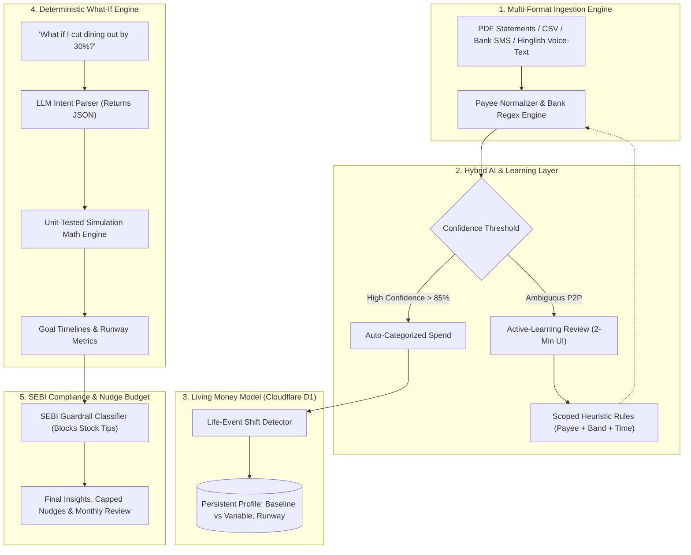

# ArthaMind (अर्थmind) 🧠💰
### Personal Finance Coach with a Living Money Model for UPI-First India

[](https://pages.cloudflare.com/)
[](https://developers.cloudflare.com/d1/)
[](LICENSE)

> **Built for the Agentic AI Hackathon (The Product Space)**  
> **Challenge:** Personal Finance Coach with a Living Money Model

---

## 🎯 Executive Thesis
Most budgeting apps categorize transactions and stop there. They treat money management as an unpaid **"productivity tax"**—forcing users to tag 50–100 micro-transactions a week until they get overwhelmed and abandon the app within two weeks.

**ArthaMind** inverts this paradigm. It is an agentic, low-homework personal finance coach built specifically for the reality of **Indian UPI spending**:
1. **Zero-Homework Active Learning:** Auto-approves high-confidence spends and surfaces only 5–10 ambiguous items in a weekly 2-minute review.
2. **P2P UPI Ambiguity Resolver:** Disambiguates *"Paid Ramesh Kumar ₹350"* using recurrence patterns, time of day, and amount bands.
3. **Reimbursement Netting:** Automatically matches and nets fronted payments (Splitwise / group dinner bills) so spending is never artificially inflated.
4. **Living Money Model:** Autonomously detects life shifts (rent hikes, new EMIs, salary increments) and updates your persistent profile with 1 tap.
5. **Deterministic Math Engine:** The LLM *never* does arithmetic. The LLM translates conversational what-if queries into structured scenarios, and a unit-tested deterministic engine calculates projections and dates.
6. **SEBI-Compliant Guardrail Layer:** Strictly separates financial education (asset classes, emergency runway, compounding) from unlicensed stock advice or buy/sell calls.
7. **Edge-Native Cloudflare Architecture:** Powered by **Cloudflare Pages/Workers** with **Cloudflare D1** serverless edge SQLite for instant responses and localized data privacy.

---

## 🏛️ System Architecture



---

## 🚀 Key Features

* **Messy Ingestion Engine:** Parses messy Indian bank alerts (HDFC, ICICI, SBI, Axis), CSV exports, and Hinglish voice/text (*"kal chai 20 diye"*).
* **Scoped Heuristic Rules:** When a user corrects a category, ArthaMind creates a scoped rule (Payee + Amount Band + Time Window) rather than a fragile one-off override.
* **Auto Sinking Funds:** Detects lumpy, seasonal recurring costs (Diwali shopping, car insurance, annual school fees) and distributes them into monthly reserves.
* **Safe-to-Spend Runway:** Replaces complex 40-category budgets with a single dynamic number: *"Safe to spend until payday"*.
* **Nudge Budget:** Caps proactive alerts per week to prevent guilt-tripping notifications.
* **Data Privacy:** On-device/edge parsing with transparent audit trails so raw financial credentials never leak.

---

## 🛠️ Tech Stack & Deployment

* **Frontend:** React 18, Tailwind CSS, Lucide Icons, Recharts
* **Backend:** Hono Framework on Cloudflare Workers / Pages Functions
* **Database:** Cloudflare D1 (Serverless Edge SQLite)
* **AI/LLM:** Cloudflare Workers AI / Google Gemini / OpenAI with deterministic JSON schema mode

---

## 📦 Setup & Local Development

```bash
# 1. Clone repository
git clone https://github.com/Argho009/arthamind.git
cd arthamind

# 2. Install dependencies
npm install

# 3. Initialize Cloudflare D1 local database
npm run d1:init

# 4. Start local development server
npm run dev
```

---

## 🌐 Deploying to Cloudflare

```bash
# 1. Login to Cloudflare Wrangler
npx wrangler login

# 2. Create Cloudflare D1 database
npx wrangler d1 create arthamind-db

# 3. Apply SQL migrations to D1
npx wrangler d1 execute arthamind-db --file=./migrations/0001_initial_schema.sql

# 4. Deploy to Cloudflare Pages
npm run deploy
```

---

*Authored with ❤️ for the Agentic AI Hackathon 2026.*
